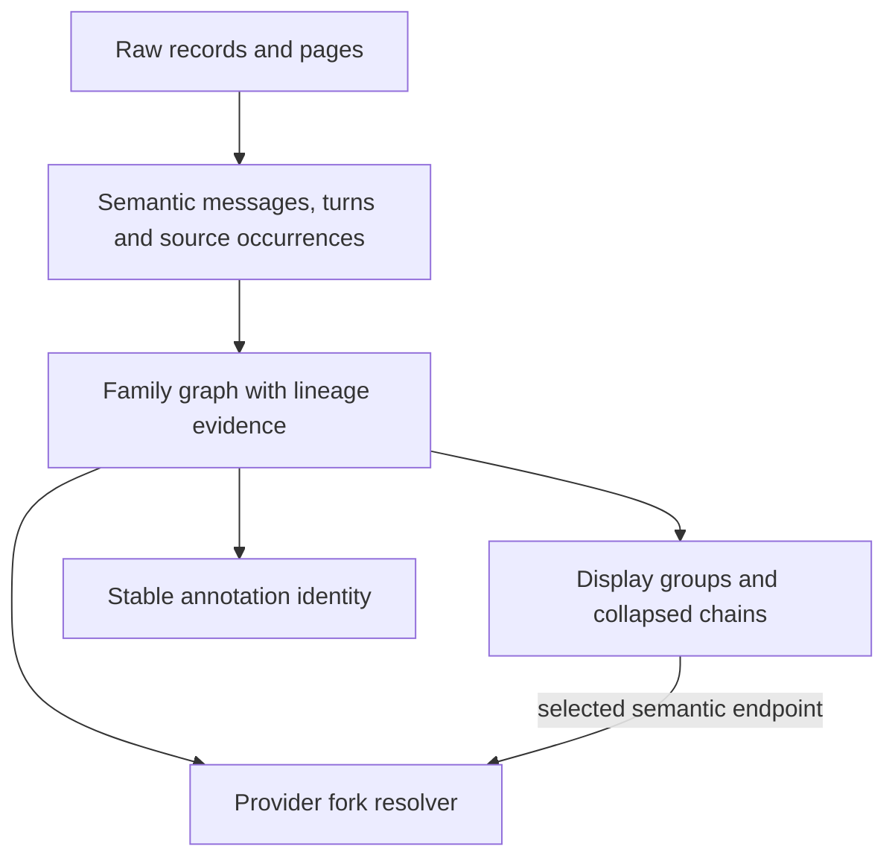

# Full modernization review, round 2 — 2026-10-27

> **Historical review, `58cf671..0bb38ae`.** Its resolution remains below; the later [round 3 review](review-findings-round-3.md) and its resolution follow. Engineering material previously in `AGENTS.md` now lives in [design.md](../../design.md).

> **Resolution (2026-10-27, same branch).** All eight findings had merit;
> each was reproduced (on the pre-fix code, by the regression test written
> for it) before being fixed. Findings 1, 4, 7 and 8 shared the cause the
> review named: one `TurnNode` field stood for a raw message, a vendor turn
> and a display group at once. The node now keeps those apart (AGENTS.md,
> "One node, several identities"), and the fixes follow from that rather
> than from patching each symptom. The owner-confirmed decisions (raw Codex
> files, the reimplemented Claude fork, no SDK, Codex writes only through
> app-server) stand.
>
> | # | Fix | Test |
> |---|---|---|
> | 1 | The display merge never folds across vendor turns (`turnId`), and a merged node's anchor and `forkBlocked` are its LAST part's — never an earlier, anchorable one. The real data's 2 affected Codex nodes: now 0. | claude: attachment tail; codex: aborted prompt; both: pipeline invariant over every fixture family |
> | 2 | One ancestry rule, `resolveLineage()`, used by the parser AND the fork writer; the writer also points a copied boundary's `logicalParentUuid` inside the copy. | claude: fork of a compacted fork; every-fork invariant |
> | 3 | Prompt keys (and Copilot/legacy text keys) digest the WHOLE normalised text; the 80/200-character gists are gone. | claude: shared 100-char preamble |
> | 4 | Direction is chronological by file creation; title suffixes only order files created in one batch. Each link carries `parentEvidence` (`explicit` / `inferred`); the panel says "probably forked from". | claude: renamed grandchild, real creation gaps |
> | 5 | Pending calls are scoped to their worker generation; `dispose` is final; a failed `postMessage` is cleaned up. | backend-client: real crashing worker |
> | 6 | A view generation, bumped by open/close, drops results for a view that's gone. | store: reload resolving after close |
> | 7 | A reload whose root is gone asks the selected turn's session and every other known member, adopts the re-rooted family, carries the selection by `stableIds`, and says so when nothing is left. Closing a tree refreshes the list. | store: deleted root; nothing left |
> | 8 | Annotations are keyed by semantic identity (`stableIds`) and written once per sidecar; v1 uuid-keyed entries are carried forward lazily and idempotently on first load. Entries whose source was deleted before that can't be mapped, and the docs say so. | claude: pre-upgrade entry outlives its root |
> | arch. | `occurrences {sessionId, id}` replace bare `aliasIds`; `branchKind: fork \| edit` replaces `crossSession`; `watchLater` retries failed target resolution and reconciles once live; the malformed fixture no longer looks like a merge conflict. | — |
> | found here | A cleared annotation field was sent as `undefined`, which JSON (the VS Code bridge) drops, so un-starring or reviving a dead end could silently do nothing there. It's sent as `null` now. | store: cleared field |
>
> Real stores after the change: 61 Claude / 87 Codex / 5 Copilot entries
> (unchanged); 20 multi-session families with no duplicate ids, dangling
> parents or extra roots; 5 parent links labelled inferred. The roadmap's A1
> (one session id in two folders), the cross-process sidecar race and the
> inferred-direction residual are recorded in AGENTS.md "Known gaps" and in
> [roadmap.md](roadmap-completed.md), which now carries the review's A1/B3/B4/C1
> cautions.

The branch is substantially better, and the provider/worker/host architecture is suitable for Agentree. I would still hold the merge for the three P1 findings below: enabled fork actions can silently omit displayed instructions, repeated forks of compacted Claude sessions lose ancestry, and prompt matching can hide a distinct branch prompt. The first issue affects two nodes in the owner's existing Codex history.

Scope: the full `58cf671..0bb38ae` modernization, including the three follow-up commits, not just their incremental diff. I reviewed the current implementation, architecture notes, handoffs, previous findings and resolution writeup, tests, build paths, renderer integration, and packaging metadata. The untracked `docs/roadmap.md` appeared during review and is considered separately below as current-state evidence and proposed future work. Implementation files were not changed during this review.

**Verification performed.**

| Check | Result |
|---|---|
| Existing suite | 43/43 pass |
| Typecheck | Pass |
| VS Code and Electron production builds | Both pass, including their worker bundles |
| Read-only scan through the built extension worker | About 3.1 s cold / 20 ms warm; a host 50 ms timer fired 51 times during the cold scan |
| Existing store | Claude: 67 files, 61 entries; Codex: 286 files, 87 entries; Copilot CLI: 5 entries; no reported parse failures |
| Recognized multi-session families | 19 checked; no duplicate node IDs, dangling parents, cycles, or disconnected roots |
| Additional isolated reproductions | Nine targeted cases for the eight numbered findings, plus two reproductions of roadmap A1/A2 |
| Full-branch `git diff --check` | Reports the deliberately malformed fixture's `<<<<<<< merge conflict` line; not an unresolved source merge |

The tree-invariant checks establish structural validity, not semantic correctness: a connected tree can still put an answer under the wrong prompt or expose the wrong fork endpoint. The targeted reproductions exercise those stronger properties. They use temporary transcript homes, mocked Codex fork calls, mocked worker events, and mocked renderer API calls. No original transcript was written and no model generation was requested. The current list also contains one duplicated Claude session identity, discussed with the roadmap items below.

1. **[P1] Same-role merging re-enables fork actions at an endpoint before text shown in the selected node. Confirmed in current data and isolated fixtures.**

   Locations: [transcripts.ts:380](../../../electron/transcripts.ts#L380), [codex.ts:775](../../../electron/providers/codex.ts#L775), [codex.ts:804](../../../electron/providers/codex.ts#L804).

   The provider sets restrictions on semantic messages, but `mergeSameRoleRuns()` subsequently selects the last part *without* `forkBlocked` and clears the merged node's restriction. It can select an earlier part while retaining later blocked parts in the displayed text. The resulting enabled action does not represent a fork after everything the user selected.

   **Codex reproduction:** a user prompt is aborted before any assistant prose; the next turn has a replacement prompt and a reply. The two adjacent user nodes merge. The selected node reads `Cancelled prompt\n\nReplacement prompt`, is forkable, and has `lastRawId` equal to the cancelled turn. The fork request therefore cuts before the replacement prompt. The later prompt's original whole-turn restriction has been erased.

   The read-only audit found **two merged Codex user nodes** in existing multi-session families whose enabled anchor is before the last prompt represented in their `absorbedIds`. This is a user-visible correctness issue, not just a hypothetical input.

   **Claude reproduction:** a normal prompt is followed by a tools-only assistant response, then a real human `queued_command` attachment. Filtering removes the tools-only node; merging combines the prompt and attachment. The fork button is enabled, but the anchor is the original prompt, so the copied file omits the displayed mid-turn instruction. No warning is returned: `crossesInjected()` only detects queue-reconstructed synthetic messages, not this real attachment.

   Preserve vendor turn boundaries through display grouping. A merged node must not become forkable by falling back to an earlier constituent while keeping later instructions in its text. For Codex, prevent cross-turn merging or keep the semantic messages selectable independently. For Claude, a group ending in an unanchorable attachment should remain blocked until there is a valid later message anchor. Enforce this in the provider/action path as well as the button.

2. **[P1] A fork of a compacted Claude fork drops its precompact ancestry and duplicates shared history. Confirmed with an isolated writer reproduction.**

   Locations: [claude-fork.ts:89](../../../electron/providers/claude-fork.ts#L89), compare the parser's repair at [transcripts.ts:684](../../../electron/transcripts.ts#L684).

   The first-generation compaction fix works. It copies the logical chain and deliberately leaves `logicalParentUuid` pointing to the source file's old UUID. The parser repairs that stale reference by file order. The fork writer does not use that repair: it looks up the old UUID only in the copied file's `byUuid` map and stops when it is absent.

   Reproduction: create a compacted session P; fork a postcompact answer into F; append a new prompt/reply to F; fork F's own reply into G. Both calls return success. G's file begins at the compact boundary and omits the earlier copied prompt/reply. Loading the family now draws duplicate postcompact history and multiple roots, although G has no new turn of its own.

   A native compacted fork with the same stale-reference format is exposed to the same writer behavior. This is distinct from the fixed first-generation parser test.

   Normalize raw-record ancestry once and share it between parsing and copying. The normalized chain must preserve all raw records needed by the writer, rather than being reconstructed from filtered display nodes. Add a repeated-fork compaction fixture and assert that another unchanged fork adds no displayed history or roots.

3. **[P1] Claude's timestamp-free prompt key merges different long prompts with the same opening. Confirmed with an isolated fixture.**

   Locations: [transcripts.ts:414](../../../electron/transcripts.ts#L414), [transcripts.ts:873](../../../electron/transcripts.ts#L873), [stitch.ts](../../../electron/providers/stitch.ts).

   Removing the endpoint timestamp fixes the previous restamping problem, but the fallback still compares only an 80-character text gist. The same-parent rule does not distinguish two alternative prompts under the same parent when their openings match.

   Reproduction: two related sessions share their opening prompt and assistant answer. Their next prompts lack `promptId`, start with the same 100-character preamble, and end respectively in `use SQLite` and `use Redis`. Their replies have distinct API message IDs. Loading the family drops the Redis prompt and hangs `Redis answer` under the SQLite prompt. IDs are unique and the tree is connected, so the existing basic tree invariants pass.

   Prompts beginning with repeated requirements, pasted context, or the same code are ordinary inputs. A display gist is not an identity key. Compare the complete normalized content, or hash the complete content, when stronger preserved prompt identity is absent. Preserve ambiguity rather than silently substituting another prompt's text. The same general caution applies to the default truncated text key used for legacy content stitching.

4. **[P2] A title-only rename can still reverse native Claude parentage, even with correct file birthtimes. Confirmed with an isolated fixture.**

   Location: [transcripts.ts:1147](../../../electron/transcripts.ts#L1147).

   The explicit-lineage cycle fix is correct, but native extension forks have no explicit lineage. Let P be the root, F its native fork titled `Root (fork)`, and G a native fork of F renamed `Renamed grandchild`. Write the files in the correct P → F → G creation order. Title depth sorts G before F. G is attached to P, then overlap makes F a child of G. Shared F-only turns are attributed to G, and the dashed session boundary moves to the wrong place.

   No restored birthtimes or corrupt sidecar is required. AGENTS.md currently describes the failure as requiring renamed titles **and** reset creation times, and says only the dashed edge flips. The reproduction also changes member parentage and canonical `sourceSessionId`, which drives the panel's native-open target.

   API message IDs establish shared history; they do not establish direction. Weaker title hints should not unconditionally outrank intact chronology. Retain evidence/provenance for inferred links and expose uncertainty in the model/UI when direction cannot be established. Explicit Agentree lineage can remain authoritative.

5. **[P2] An old worker's exit event rejects requests already sent to its replacement. Confirmed with a worker-event reproduction.**

   Location: [backend-client.ts:35](../../../electron/backend-client.ts#L35).

   Both worker handlers call the global `failAll()` even when their emitting worker is no longer current. A crashed worker emits `error` and then `exit`. After `error`, the client clears `worker`, rejects the first request, and allows the caller to retry on a new worker. The old worker's subsequent `exit` rejects the replacement worker's request too. Its eventual successful reply has no pending recipient.

   The reproduction runs exactly that sequence: first request → old `error` → retry on new worker → old `exit` → retry rejects with the old exit code.

   Scope pending requests and failure handling to a worker generation, or ignore late terminal events from a worker that is no longer current. Also make disposal terminal and remove a pending entry if construction/postMessage throws. The latter are source-level cleanup observations; the generation race itself is reproduced.

6. **[P2] A pending reload can reopen a conversation after the user closes it. Confirmed with a store reproduction.**

   Locations: [store.ts:157](../../../src/store.ts#L157), [store.ts:175](../../../src/store.ts#L175), [store.ts:194](../../../src/store.ts#L194).

   `reloadSession()` captures the current session, awaits the backend, then unconditionally installs the result. `close()` clears the state but does not invalidate that pending result. Start a reload, close the view, then resolve the reload: the closed conversation reappears.

   This is a pre-existing renderer lifecycle race, made more relevant by the asynchronous worker boundary and responsive host. Unsubscribing filesystem watches does not cancel a reload already in flight. Add a view/request generation and check it before committing results from open/reload calls. Preserve the existing coalescing and selection-follow behavior within a valid generation.

7. **[P2] Deleting a family root leaves the open view permanently bound to a vanished session ID. Confirmed from provider behavior and a store reproduction.**

   Location: [store.ts:178](../../../src/store.ts#L178).

   The providers can now load a surviving member and reconstruct a re-rooted family. The open view never asks them to: every reload uses `prev.meta.id`, and a null result leaves the old tree untouched. After P is removed while F survives, every later disk notification asks for P again. Changes through F never appear in that open tree.

   The reproduction resolves the root lookup to null repeatedly and verifies that the view keeps querying and displaying the deleted root despite retaining a surviving child in `session.members`.

   A family's live identity cannot be just the current physical root's session ID. Retain candidate member IDs or a stable family/view handle, try surviving members on root loss, and remap selection through known identities where possible. Reconcile the welcome list when returning from an open family as well; it is not refreshed merely by installing a new watch.

8. **[P2] Existing annotation files are not migrated into the new deletion-survival scheme. Confirmed with the committed Claude fixtures.**

   Locations: [meta.ts:77](../../../electron/meta.ts#L77), [meta.ts:96](../../../electron/meta.ts#L96).

   Alias-aware reads and replicated **new** writes solve the new-annotation case. Older annotations remain only under the former root's raw UUIDs. Merely loading the upgraded family does not persist aliases or replicate them. Delete the root later and those annotations disappear from the surviving copy.

   Reproduction: save `{label: "existing annotation"}` under P's `p-a2` using the pre-upgrade sidecar format; load P and see the label; remove P's transcript; load F and the label is gone. The current deletion regression writes through the new `annotate()` path first, so it misses this upgrade case.

   Migrate/backfill existing annotations while the source-to-copy identity mapping is available, with an explicit migration/version strategy. Persist durable semantic identity or an alias index, rather than relying only on transient arrays reconstructed from files that can later disappear. Already-deleted source transcripts can make old UUID-only annotations impossible to map; do not promise recovery the stored data cannot support.

**Assessment of the prior fixes.** The changes are substantive, not cosmetic. The seven existing copied-prefix Codex links now join: 87 entries versus 94 before. Any-assistant-ID Claude grouping fixes regenerated-first-answer discovery; whole-tree overlap fixes the tested parent-rewind case; explicit ancestry ordering prevents the previous explicit-lineage cycle. The early-usage accumulator, failed-versus-hidden health distinction, index identity invalidation and polling, native-resume wording, package metadata, and worker split address their intended defects. The official [VS Code 1.101 release notes](https://code.visualstudio.com/updates/v1_101#electron-35-update) identify Node 22.15.1 in Electron 35, and [Node's zstd documentation](https://nodejs.org/download/release/v26.3.0/docs/api/zlib.html#zlibzstddecompresssyncbuffer-options) confirms the 22.15 runtime requirement, supporting the corrected minimum.

The remaining partial fixes are previous finding 4 (only first-generation compaction copying), finding 6 (restrictions set before merging are subsequently overridden), finding 8 (old annotations versus newly replicated writes), and finding 9 (endpoint restamping fixed with an unsafe short text key). Native title-based inference remains weaker than the documentation suggests. The historical Codex page limitation is now honestly handled by routing through a thread that still holds the turn or refusing it, preserving the official-API-only write decision.

**Architecture and data model.** Keep the current provider adapters, local filesystem reads, official Codex write API, Node-free renderer, typed host bridge, shared renderer, and backend worker. Raw page parsing is appropriate for discovering edit branches that the active-path API omits. The extension host bundle is now much smaller than its worker bundle, and the measured timer behavior supports the responsiveness claim. A database/server rewrite is not needed to address these findings.

The important change is to separate three semantic units that currently share `TurnNode`: a harness message/raw anchor, a vendor turn such as a Codex request plus all responses, and a presentation group produced by same-role folding. `lastRawId` is a Claude record UUID, a Codex turn UUID, or a Copilot event UUID depending on context. `forkBlocked` is attached to messages and then rewritten by a generic display merge. That abstraction allows finding 1.

One logical message can also occur in multiple physical sessions, with different raw UUIDs and different legal resume contexts. A flat `aliasIds: string[]` plus one canonical `sourceSessionId` loses the ownership of each alias. It is useful for display deduplication, but insufficient as a durable source/action model. An explicit occurrence record can retain the session ID, physical file/page locator, message/turn anchor, and relevant capabilities; a stable semantic message ID can then key annotations. This would also make choosing a valid copy of shared history an intentional provider decision. The physical locator matters because the roadmap's moved-project case shows that even one session ID can have multiple files.

The layers can remain small:

The action resolver should prove that an enabled cut includes every represented instruction and excludes later ones. Layout compression should have no authority over that cut. A single shared raw ancestry resolver should serve Claude rendering and copying. Persist whether family edges are explicit or inferred so the UI does not present weak direction guesses as harness facts.

Family handles also need to survive changes in which physical file happens to be the root. The worker request generation and renderer view generation solve different problems; both are needed. Worker recovery should cover subscriptions as well as individual calls. `watchLater()` currently discards target-resolution failures and leaves the view unwatched; the comment about reloading on demand is misleading because the normal UI has no refresh action. Surface/retry that condition and reconcile once a watch is installed to cover the read-to-watch gap. Preserve the reason for an edge as well: `crossSession` currently conflates a fork with a prompt edit, while roadmap B4 needs to distinguish them for branch labels. An explicit fork/edit edge kind avoids inferring that distinction later from canonical node ownership.

Annotation replication is a pragmatic short-term retention mechanism, but `writeAnnotation()` currently performs a complete read/modify/write/rename for **every ID in every member**. With M members and A represented IDs it does M × A file replacements for one click, and the ID count itself grows with copied/merged history. Batch all updates to each sidecar into one atomic replacement. Independent app/extension workers can also write the same sidecars, so a future canonical store needs a concurrency and conflict policy; atomic rename alone is not an atomic multi-writer transaction. These are source-level scalability/consistency concerns, not reproduced data-loss claims in this review.

**Known roadmap correctness work remains applicable.** A1/A2 are concrete data-model problems, not merely presentation requests. I confirmed one duplicated `provider:id` in the current welcome list: its two cards report 52 and 16 nodes, and both open the same 52-node file. The current directory enumeration happens to choose the larger 23.5 MB file; there is no canonical-source rule. An isolated fixture with the old folder enumerated first lists the same ID twice and loads only the old prefix, hiding the continuation in the second file. Removing the old copy then demonstrates A2 separately: the remaining file's later records use a new cwd, but its metadata/resume directory remains the first, old cwd. The roadmap's observations about duplicate React keys and missing global Claude family grouping agree with the code. A3's activity-versus-maintenance timestamps and A4's defensive list identity are sensible follow-up correctness work. B's provider filter, searchable member names, and C's settings are planned product features; their absence is not counted as a new defect here.

Before implementing A1's newest/largest canonical-file rule, prove that the discarded copy is actually subsumed. Two copies of a session can retain the same prefix and later receive different suffixes; choosing one by recency or bytes would discard a real branch. Preserve/merge both record DAGs or surface a conflict when neither dominates the other. Discovery should index logical session IDs across physical files and project folders before family grouping. Keep project attribution/filtering separate from identity. Keying cards by `provider:id` is appropriate after that logical deduplication; by itself it does not fix duplicates of the same provider/session.

The roadmap's lightweight member summaries are a good fit: retain member IDs, names, cwd, and activity metadata on the family listing without loading every conversation into the renderer. For focus, account for a member with no unique suffix yet, and for shared turns whose canonical `sourceSessionId` belongs to another member. Source occurrences make that membership explicit. Settings that move roots will need watcher/cache rebinding as well as a list refresh; an already-installed watch does not follow the new path automatically.

**Tests and remaining verification.** The test suite now covers substantially more real transcript structure. The next regressions should assert behavioral invariants through the whole parse → stitch → display-merge → fork pipeline: every enabled endpoint includes all selected instructions; different complete prompts remain distinct; another unchanged fork, including a fork-of-fork after compaction, adds no history; old persisted annotations survive an upgrade; stale worker/view events cannot modify a new generation. Parser unit tests and a fake app-server remain useful, but do not establish vendor-loader compatibility by themselves.

I did not repeat billable Claude resumes, mutate real sessions, or visually drive the VS Code webview. Tool-heavy/parallel-tool Claude resumes, compacted vendor-loader resumes, native deep-link navigation, out-of-workspace opening, and macOS/Linux terminal execution remain explicitly unverified. Memory behavior under very large fork families and annotation fan-out was not benchmarked. The precompact-fork refusal, omitted code-rewind snapshots, Copilot Chat, canary, subagent lanes, and installer remain scope decisions. The malformed health fixture should use an invalid line without a conflict-marker prefix so ordinary diff checks remain useful.

Fix findings 1–3 before treating the branch as correct for branched-chat viewing and continuation. Address the lifecycle and persisted-identity cases alongside the corresponding model changes. The current architecture is viable; the required work is to make semantic identity and action boundaries hold consistently across its layers.
